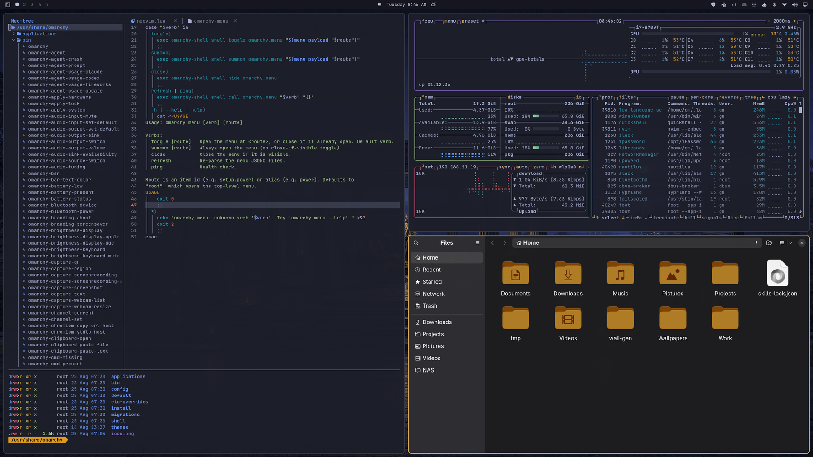
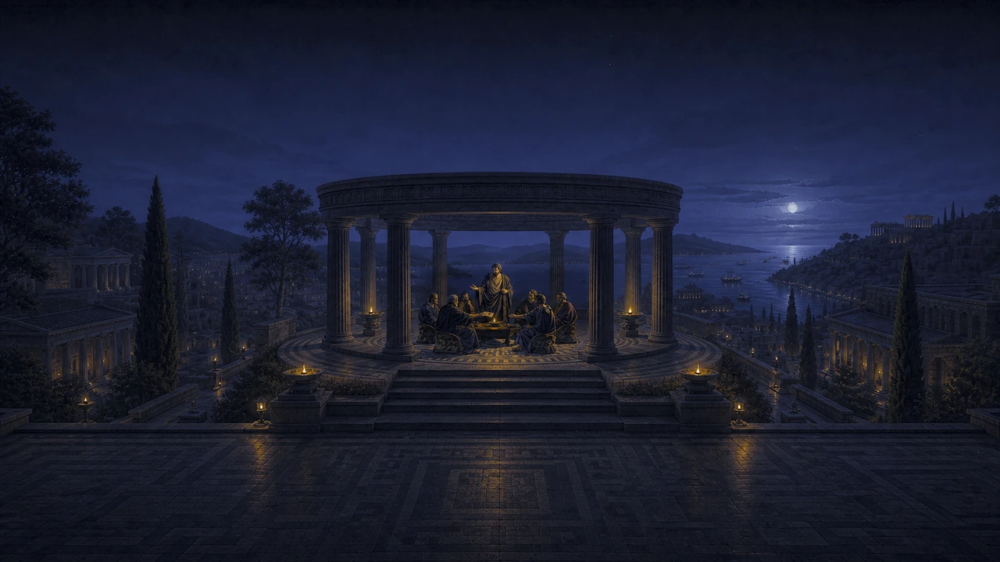
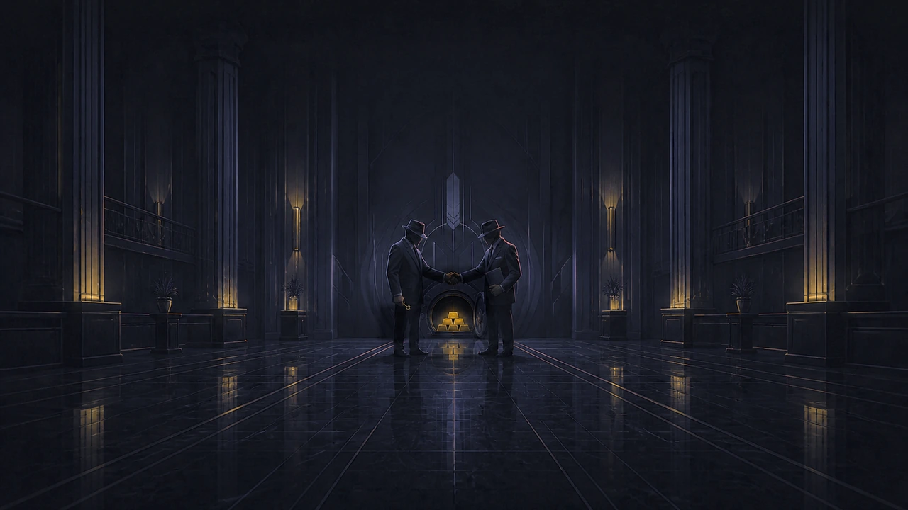
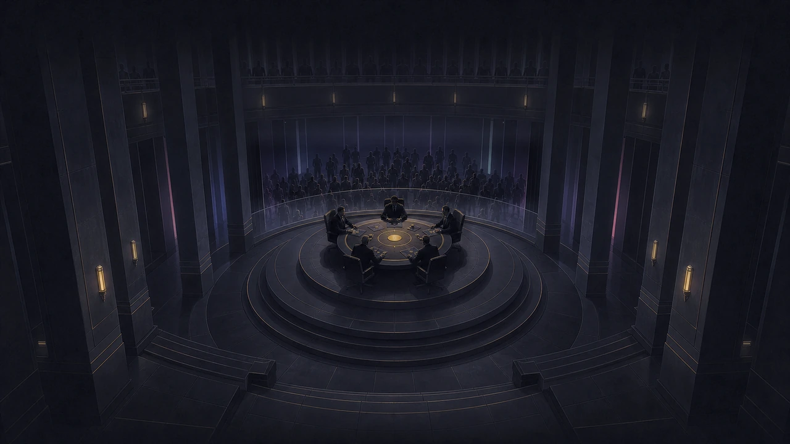
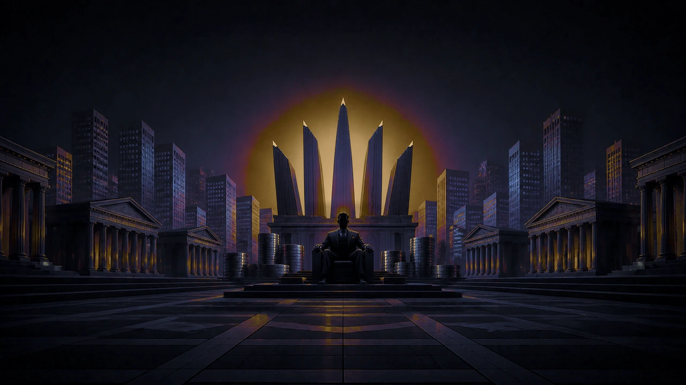
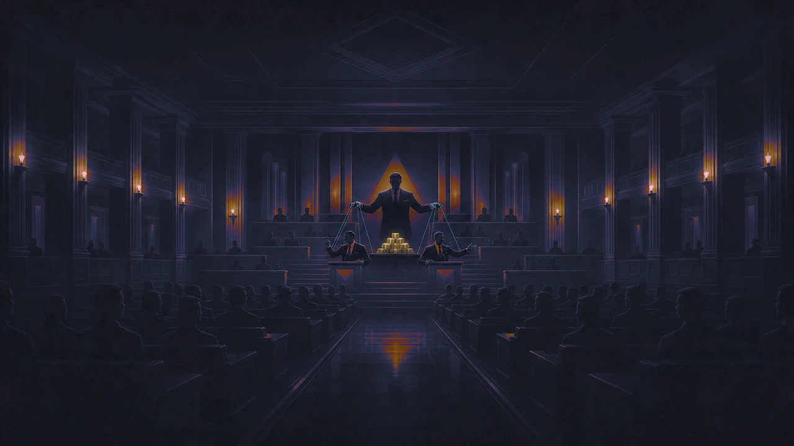

# Oligarchy

A dark theme for [Omarchy](https://omarchy.org), for those who have
concentrated a great deal of power and would like their terminal to reflect
that.



## Install

```bash
omarchy theme install https://github.com/thisisgm/omarchy-oligarchy-theme.git
```

Oligarchy ships with five wallpapers. You may select any of them. This is what
choice looks like.

## The three rules

1. **Power sits at the centre.** Every composition puts a small group in the
   middle and arranges everything else around it. This is good composition. It
   is also an org chart.
2. **Wealth is a controlled signal.** Gold never covers more than eight percent
   of a wallpaper and usually covers about one. Scarcity is what gives it
   value. We are told this is true of other things as well.
3. **Architecture is hierarchy.** Columns, platforms, chambers, sightlines. If
   you cannot tell who is in charge, look at what the room is pointing at.

## Palette

Gold `#dcae5e` is the only colour with a job. It means focus, and nothing else
is permitted to mean focus. Every other colour is ground.

The surfaces are five steps on a single hue, OKLCH 278, which is the
chroma-weighted mean hue of this theme's own wallpapers, so the desktop and the
wall it hangs on are the same material. Each step is an even 0.0340 in OKLab
lightness, held to within a third of one representable 8-bit value. Depth is
the step, not a shadow.

Every colour in the theme clears WCAG AA, 4.5:1, against all four surfaces.
Foreground over background measures 8.23:1, the accent 8.10:1, and comments,
which are usually the first thing a dark theme gives up on, measure 5.06:1.

### Why the ANSI ring is repaired, not replaced

The ring is Tokyo Night, kept because it is good and familiar, and fixed where
it is measurably broken. Tokyo Night's ring collapses under colour-vision
deficiency. Simulating protanopia, deuteranopia and tritanopia and measuring
the worst case in OKLab:

| pair | Tokyo Night | Oligarchy |
| --- | --- | --- |
| tightest pair meaning two different things | 0.0031 | 0.0324 |
| `blue` against `bright_magenta` | 0.0031 | 0.0968 |
| `yellow` against `green` | 0.0085 | 0.1128 |
| `brown` contrast on the canvas | 2.19:1 | 5.06:1 |

Solving for worst-case separation lifts the tightest confusable pair by a
factor of 10.3, while every colour stays close enough to its seed to still
answer to its name. Two rules did the work. A colour and its bright variant
separate by lightness rather than hue, so emphasis survives colour blindness.
And `bright_green` leads `bright_red` by at least 0.21 in lightness under every
vision type, so a diff's `+` is still the lighter of the pair when hue is gone.

`red` carries the most chroma in the ring, because an error that fails to alarm
has failed.

## Backgrounds

Five scenes at 6016 x 3384, 16:9 6K, sRGB. They are dark on purpose: mean
relative luminance stays between 0.013 and 0.018, so the wallpaper is ground
and never figure, and the top of the frame stays clear enough for the bar to
read over it. Centred compositions were checked at 16:9, 16:10, 21:9 and 4:3;
every subject survives the crop.

### 01 · Quarterly Alignment



Seven people on a marble platform settle what the city below will do next
quarter. The city was not invited. It has, however, been kept fully informed.

### 02 · Synergy



Two parties reach an agreement in front of an open vault. Neither is obliged to
say what was agreed. The vault is the minutes.

### 03 · Stakeholder Meeting



Five seats at the table. The stakeholders are present, engaged, and behind
glass. Feedback is welcomed through the appropriate channel.

### 04 · Founder Mode



One visionary, one chair, and a skyline arranged into a crown. The coins were
stacked by somebody else. Founder Mode does not extend to stacking.

### 05 · Board Approval



The board speaks with one voice. Two of them, in fact. The strings are
load-bearing.

The default is **01 · Quarterly Alignment**, because it is first, and being
first is the whole idea. Cycle with `omarchy theme bg next`.

## The DHH edition

There is a companion repo where the same five scenes carry DHH's likeness,
built for his Oligarchy theme competition. Same palette, same geometry, one
extra face:
[omarchy-oligarchy-dhh-theme](https://github.com/thisisgm/omarchy-oligarchy-dhh-theme).

This repo is the plain one, and it is the one listed on
[omarchy.org/themes](https://omarchy.org/themes/).

## Notes

Backgrounds are JPEG because that is what Omarchy's own themes ship and what Qt
decodes without an extra package; 61 of the 92 stock backgrounds are JPEG. At
quality 95 with no chroma subsampling they measure 48.4 dB PSNR against a
lossless reference, and a flat dark patch keeps every one of its 33 distinct
levels, so the large smooth shadows do not band.

`preview.png` is a real 2560 x 1440 capture of the theme running on Omarchy
Quattro, in the same composition the stock themes use: Neovim over the Omarchy
source, btop, and Files. Nothing in it is mocked up. The wallpapers carry no
logo, no readable text and no watermark. Omarchy's wordmark appears only in the
unlock assets, recoloured to the accent, under its upstream MIT notice.

Icons are `Yaru-yellow`. btop and Chromium are themed by Omarchy from
`colors.toml`, so this theme does not ship its own copies of files the
distribution already generates correctly.

Oligarchy is an independent theme. It is not affiliated with, endorsed by, or
in any way a governance proposal to Basecamp.

## Support

If Oligarchy earned a place on your desktop, you can
[buy me a coffee](https://buymeacoffee.com/thisisgm).

## License

MIT. See [LICENSE](LICENSE), which also carries the complete upstream MIT
notice for the recoloured Omarchy wordmark.
